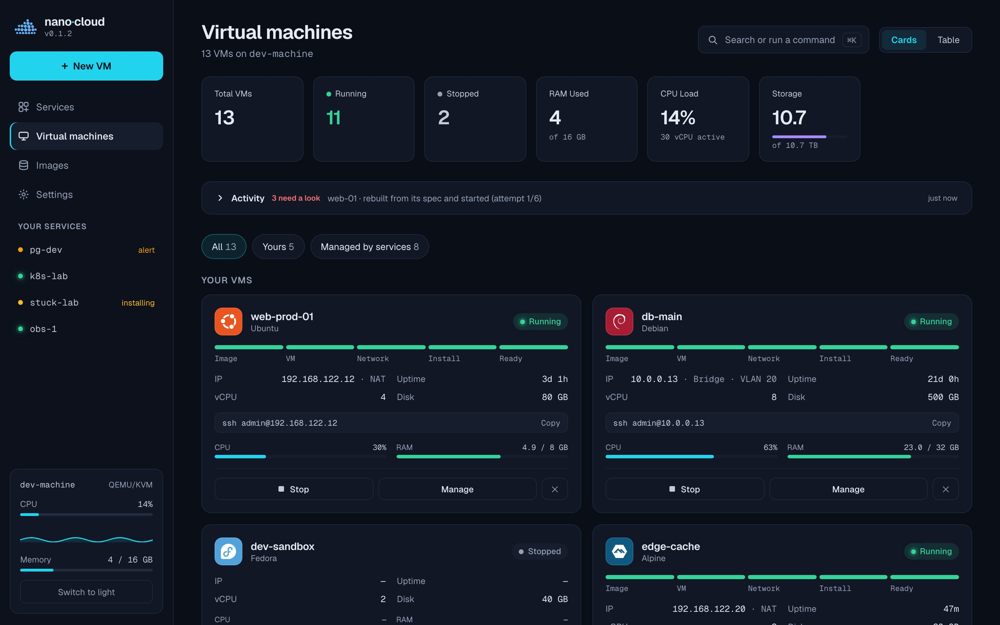

# Nano Cloud

Your own cloud, on hardware you own. Nano Cloud runs virtual machines,
databases, S3 storage and Kubernetes clusters from one static binary on a
Linux box, and its web console tells you what's true without a terminal.

<picture>
  <source media="(prefers-color-scheme: light)" srcset="site/screens/dashboard-light.jpg">
  
</picture>

[Website](https://nanocloud-io.github.io/nanocloud/) ·
[Live demo](https://nanocloud-io.github.io/nanocloud/demo/), with sample data
and nothing to install

[](https://github.com/nanocloud-io/nanocloud/actions/workflows/ci.yml)
[](https://github.com/nanocloud-io/nanocloud/releases/latest)
[](LICENSE)

## Install

You need an x86-64 Linux host with KVM (Ubuntu, Debian, Fedora or a
relative) or an Apple silicon Mac. A Linux ARM64 build exists but can't
create VMs yet.

```sh
curl -fsSL https://raw.githubusercontent.com/nanocloud-io/nanocloud/main/install.sh | sudo sh
```

The installer fetches the release for your platform, checks its GPG
signature and checksum, installs libvirt and QEMU from your distro's packages
on Linux, and starts the service. Then it prints the address to open and a
generated password. The certificate is self-signed, so your browser warns
once; compare the fingerprint the installer printed.

To pin a release, put `NANOCLOUD_VERSION=v0.2.0` before `sh`.

## What it does

One binary holds the daemon, the API and the web UI. No database, no
containers, no second runtime: state is libvirt's own XML plus JSON files you
can read.

It comes back on its own. After a power cut, a crash or a botched upgrade,
every VM you asked to run is started again, with back-off. A machine whose
definition is lost is rebuilt from its disk, and the activity feed says what
happened.

- Services in one click: PostgreSQL, MySQL, S3 storage, a Kubernetes
  cluster, Prometheus with Grafana. Each recipe provisions VMs and hands you
  a connection string.
- Every VM and service on one screen, with CPU, memory, disk and health, and
  a browser console (VNC or serial) for each VM.
- On Linux: PCI and USB passthrough, CPU pinning and topology, UEFI with
  Secure Boot and TPM, bridged and VLAN networking.
- A JSON API for scripts, with API tokens; it's the one the UI uses. It isn't
  versioned yet, so a release before 1.0 can change it.

On a Mac it runs on Apple's Virtualization.framework. That's the place to try
it; Linux is the place to run it. [MACOS.md](MACOS.md) has the differences.

## What it does not do

So you know what you're getting:

- No users, roles, SSO or tenants. One login and API tokens.
- No clustering. One box is the unit.
- No container runtime, Kubernetes distribution or model runtime inside the
  binary. They run inside the VMs it provisions.
- No hosted version, and no telemetry. The one outbound call the daemon makes
  on its own is a check for a newer release, at most every 12 hours, which
  you can turn off in Settings.

### Compared with Proxmox VE, MicroCloud and Cockpit

| | Nano Cloud | Proxmox VE | Canonical MicroCloud | Cockpit Machines |
|---|---|---|---|---|
| Installs onto | Your existing distro, or a Mac | Its own Debian-based OS | Ubuntu, as snaps | Your existing distro |
| Delivery | One binary | A distribution | LXD, MicroCeph and MicroOVN | A set of packages |
| Smallest useful setup | One machine | One machine | Three machines for high availability | One machine |
| Runs | VMs | VMs and containers | VMs and system containers | VMs |
| Restarts crashed VMs | Yes, with back-off | Yes, with its HA stack (cluster) | At boot, and off a failed cluster member | No |
| Managed services (Postgres, S3, k3s) | Built in | No | No | No |
| Clustering, storage replication | No | Yes | Yes | No |

If you need a cluster, Ceph or live migration, use Proxmox or MicroCloud.

## Use

| | |
|---|---|
| Update | `sudo nanocloud update` (the UI shows when one is out). `--check` reports only; `--version vX.Y.Z` picks a release. A failed update puts the previous binary back. |
| Health check | `nanocloud doctor` |
| Reset the password | `sudo nanocloud passwd` |
| Uninstall, keeping VMs | `sudo nanocloud uninstall` |
| Remove everything | `sudo nanocloud uninstall --purge` (deletes VMs, disks and all state) |

Configuration lives in `/etc/nano-cloud/config.yaml`. Settings that can change
while the daemon runs (storage pools, recovery, update checks) are in the UI.

## Security

The daemon runs as root, because it manages VMs, disks and host networking.
It listens on every interface over HTTPS and requires a login.
[SECURITY.md](SECURITY.md) says what that does and doesn't protect, and how
to report a vulnerability.

## Build from source

```sh
make all          # builds the UI, then the binary with the UI embedded
sudo ./nanocloud install
```

You need Go (version in `go.mod`) and Node.js (version in `.nvmrc`).
[CONTRIBUTING.md](CONTRIBUTING.md) covers tests, the dev server and pull
requests; [ARCHITECTURE.md](ARCHITECTURE.md) explains how the pieces fit.

## License

[Apache License 2.0](LICENSE). Third-party notices are in [NOTICE](NOTICE).
